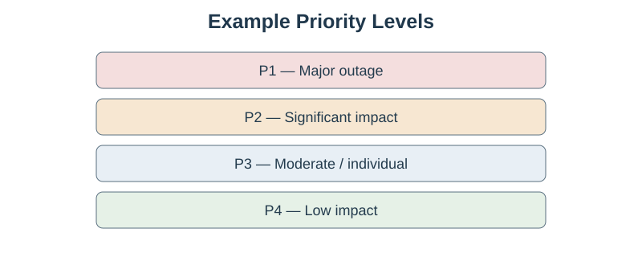

# Priority and SLA concepts

Illustrative priority examples; do not treat these as universal definitions or SLA promises.

| Example | Scenario | Handling |
|---|---|---|
| P1 | Widespread critical service outage | Major incident coordination and frequent approved updates |
| P2 | Significant impact, limited workaround | Prioritized investigation and escalation |
| P3 | Individual or moderate impact | Standard queue handling |
| P4 | Low impact | Standard or planned handling |

Assess impact and urgency using the organization’s defined matrix. Response and resolution targets vary by contract and policy.
